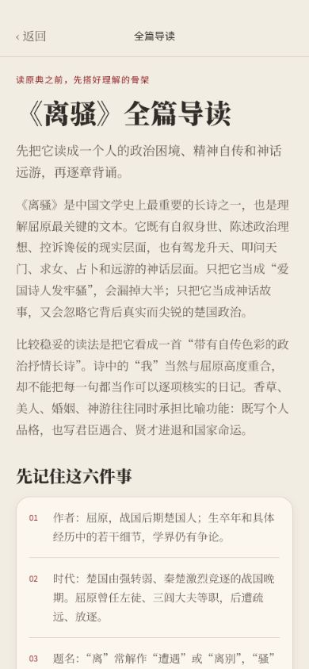
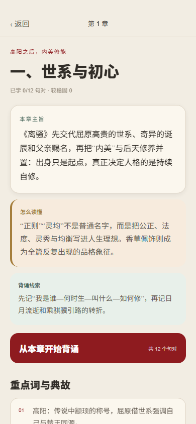
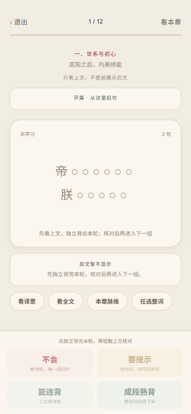
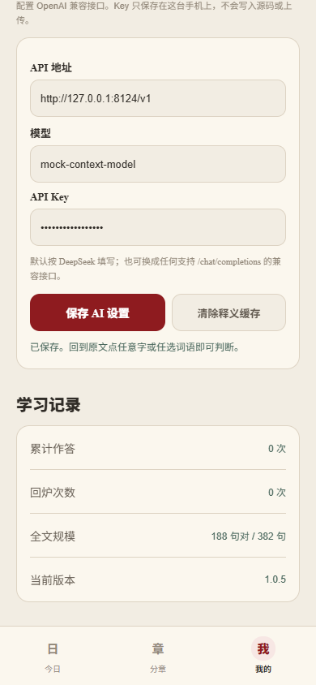

# 离骚背诵

一个离线优先的《离骚》精读、点字查词与背诵 App。当前自用版为 `1.0.5`。

## 下载

- [GitHub Releases](https://github.com/c6823821-sketch/lisao-recite-app/releases/latest)
- 当前安装包构建完成后会更新为 `1.0.5`。


## 页面

| 今日 | 分章 |
| --- | --- |
|  |  |

| 全篇导读 | 分章精读 |
| --- | --- |
|  |  |

| 点字查读音与释义 | 背诵 |
| --- | --- |
|  |  |

| 学习档案 |
| --- |
|  |

| 应用内检查更新 |
| --- |
|  |

## 内容

- `382` 个原文分句，`188` 个背诵句对，`15` 个语义章节。
- 全文 `808` 个不重复汉字，`100%` 可在原文中点击查看读音、通用义项和本句语境。
- 每个单字先显示当前句中的取义、语法作用或所在词语，字典通用义项默认收起。
- 全文 `2,489` 个单字位置均有本句字义卡，另有 `243` 条按分句定位的逐句注释。
- 可在“我的 → AI 本句释义”配置 OpenAI 兼容接口，按当前原句判断任意字词的语境义。
- AI 判断失败时明确提示错误并退回离线字义，不把离线推断伪装成 AI 结果。
- 每个句对包含原文与现代汉语译意；每章另有历史处境、故事线、深度解读和读后问题。
- 全篇按句对使用 FSRS 记忆曲线安排复习。
- 每日可设置新学 `4 / 8 / 12 / 16` 个句对，到期复习额外加入。
- 分章页和章节详情可直接“只背本章 / 继续本章 / 复习本章”。
- 背诵只显示已完成的“上文”和当前待背句，不提前展示下一句；进入下一组后再接续。
- 原文可任选连续词语，整词可查逐字读音、义项、本句语境义和整句译意。
- 支持遮字、全文核对、译意提示、隔组回炉和四档自评；不会或要提示时先看讲解再继续。
- “我的”会列出今天背过什么、已学原句、掌握程度、上次评分和下次复习时间。
- 应用内检查 GitHub 正式版、下载更新并调用 Android 系统安装器。
- 更新检查和下载带国内镜像回退，GitHub 直链受限时仍可继续。
- 所有学习记录、AI 设置和 AI 释义缓存只保存在本机；仅在查询本句释义时把原句、译文和所选字词发送到用户配置的 API。

## 原文

原文取自现有诗词项目内置《离骚》完整文本，来源标注为
`chinese-poetry/chinese-poetry`（MIT）。现代译意、分章、词注和背诵资料为本 App 本地内容。

## 开发

```powershell
pnpm install
pnpm run check
pnpm run export:web
```
