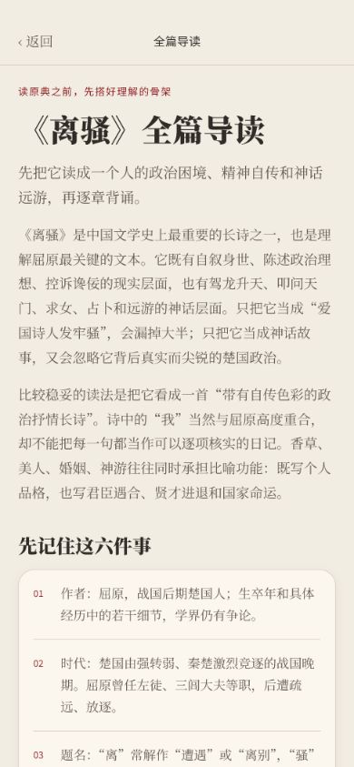
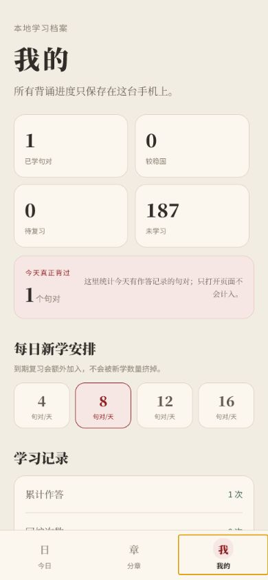

# 离骚背诵

一个完全离线的《离骚》精读、点字查词与背诵 App。当前正式版为 `1.0.2`。

## 下载

- [GitHub Releases](https://github.com/c6823821-sketch/lisao-recite-app/releases/latest)
- 当前安装包为 Android 7.0+ ARM64 版本。
- 大小：26,426,762 字节
- SHA256：`2ED9EC8B76719CF28882B4C703CD72EB513886EC8E9F938A6A3210421F8D149A`


## 页面

| 今日 | 分章 |
| --- | --- |
|  |  |

| 全篇导读 | 分章精读 |
| --- | --- |
|  |  |

| 点字查读音与释义 | 背诵 |
| --- | --- |
|  |  |

| 学习档案 |
| --- |
|  |

| 应用内检查更新 |
| --- |
|  |

## 内容

- `382` 个原文分句，`188` 个背诵句对，`15` 个语义章节。
- 全文 `808` 个不重复汉字，`100%` 可在原文中点击查看读音、通用义项和本句语境。
- 每个句对包含原文与现代汉语译意；每章另有历史处境、故事线、深度解读和读后问题。
- 全篇按句对使用 FSRS 记忆曲线安排复习。
- 每日可设置新学 `4 / 8 / 12 / 16` 个句对，到期复习额外加入。
- 背诵以“上文 → 本轮 → 下文”连续呈现，章节交界也不截断。
- 原文可任选连续词语，整词可查逐字读音、义项、本句语境义和整句译意。
- 支持遮字、全文核对、译意提示、隔组回炉和四档自评；不会或要提示时先看讲解再继续。
- “我的”会列出今天背过什么、已学原句、掌握程度、上次评分和下次复习时间。
- 应用内检查 GitHub 正式版、下载更新并调用 Android 系统安装器。
- 更新检查和下载带国内镜像回退，GitHub 直链受限时仍可继续。
- 所有学习记录只保存在本机。

## 原文

原文取自现有诗词项目内置《离骚》完整文本，来源标注为
`chinese-poetry/chinese-poetry`（MIT）。现代译意、分章、词注和背诵资料为本 App 本地内容。

## 开发

```powershell
pnpm install
pnpm run check
pnpm run export:web
```
