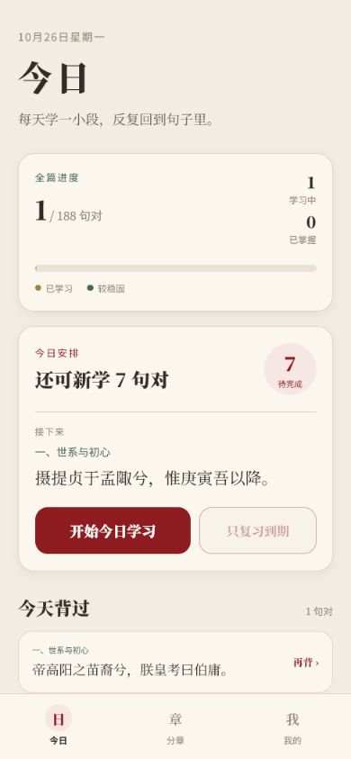
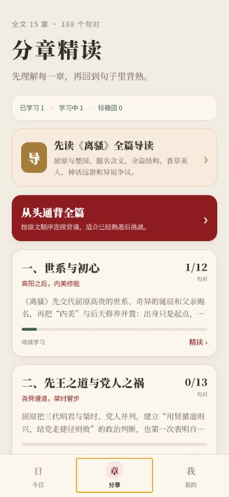
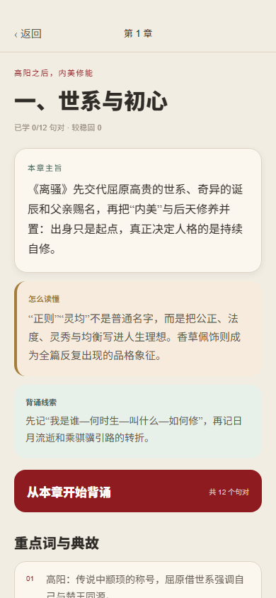
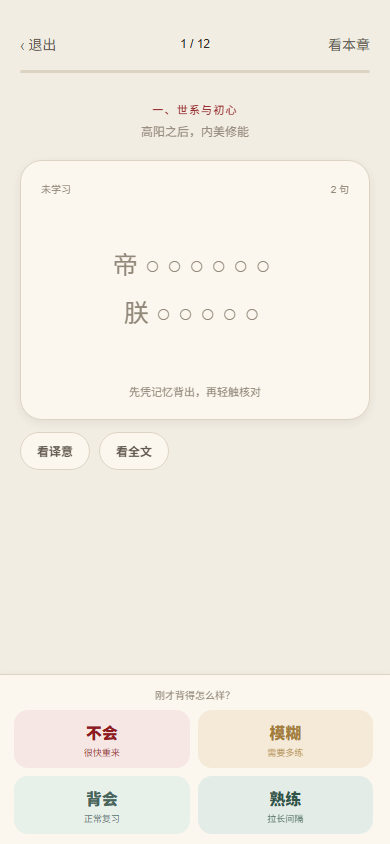

# 离骚背诵

一个完全离线的《离骚》精读与背诵 App。

## 下载

- [GitHub Releases](https://github.com/c6823821-sketch/lisao-recite-app/releases/latest)
- 当前安装包为 Android 7.0+ ARM64 版本。
- SHA256：`5A25C032B12C8452D5350276EDAA1FDE22F811D299B3D78C45DA32FA3C707194`


## 页面

| 今日 | 分章 |
| --- | --- |
|  |  |

| 精读 | 背诵 |
| --- | --- |
|  |  |

## 内容

- `382` 个原文分句，`188` 个背诵句对，`15` 个语义章节。
- 每个句对包含原文与现代汉语译意。
- 每一章包含主旨、理解方法、背诵线索和重点词/典故。
- 全篇按句对使用 FSRS 记忆曲线安排复习。
- 每日可设置新学 `4 / 8 / 12 / 16` 个句对，到期复习额外加入。
- 背诵支持遮字、全文核对、译意提示、不会回炉和四档自评。
- 所有学习记录只保存在本机。

## 原文

原文取自现有诗词项目内置《离骚》完整文本，来源标注为
`chinese-poetry/chinese-poetry`（MIT）。现代译意、分章、词注和背诵资料为本 App 本地内容。

## 开发

```powershell
npm run check
npm run export:web
```
